# NA29 Islands

Rosé Pine islands for terminals and coding agents. A quieter desktop with
numbered workspaces, vim-style navigation, a searchable activity log, and a
status bar that keeps the useful details close.

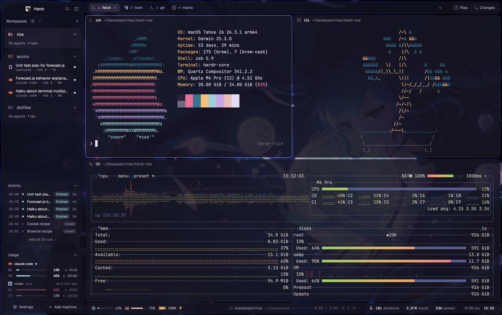

*Wallpaper in the screenshots: third-party anime art, not included in this repo.
Bring your own (see [wallpapers](docs/ASSETS.md)); the default is a gradient.*

## A tour

### Islands layout

`na29-islands` separates the sidebar, tabs, terminal panes, and status bar into
rounded islands, with 5px gaps and 10px corners, floating over your wallpaper
(see the screenshot above). Files and Changes in the top bar open a fourth island on the
right: a file tree with git marks and a diff/commit panel, in the same cards
and type as the sidebar.

### Wallpaper, dimming, and three transparency layers

| See-through on | See-through off (darkest solid background) |
| --- | --- |
| 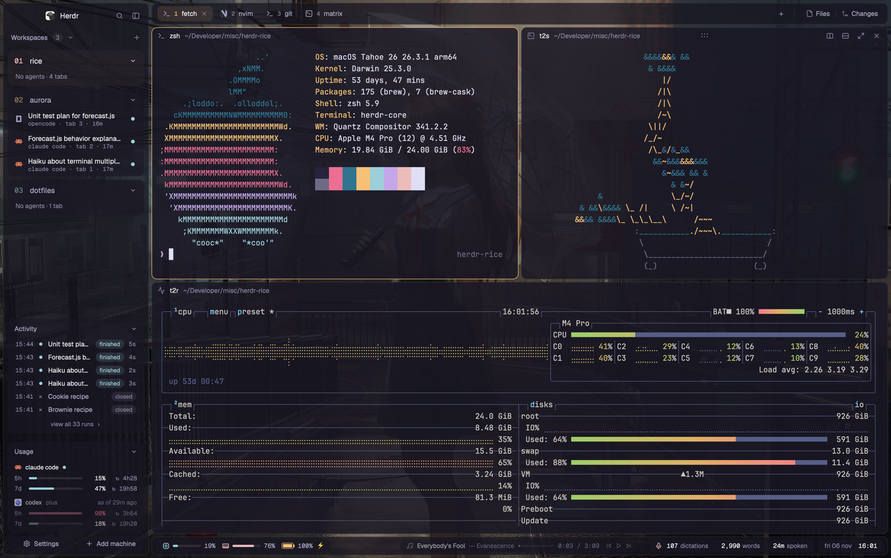 | 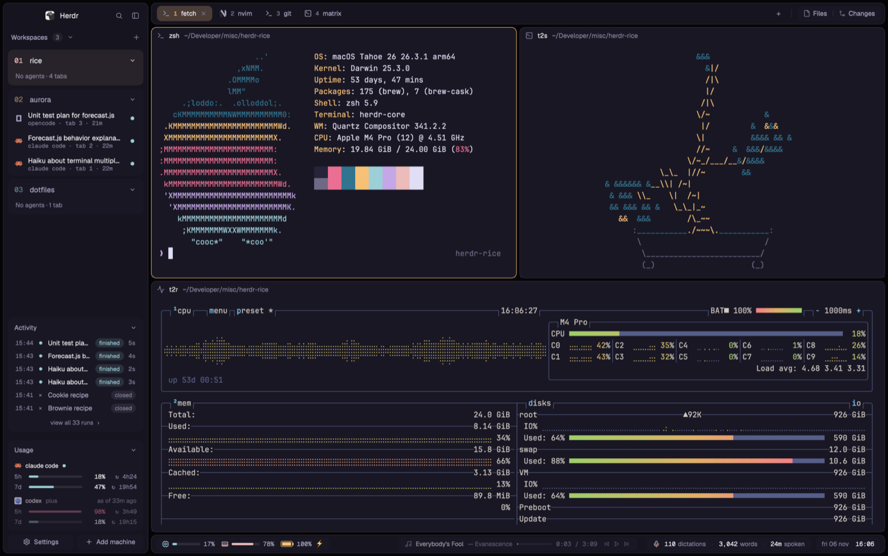 |

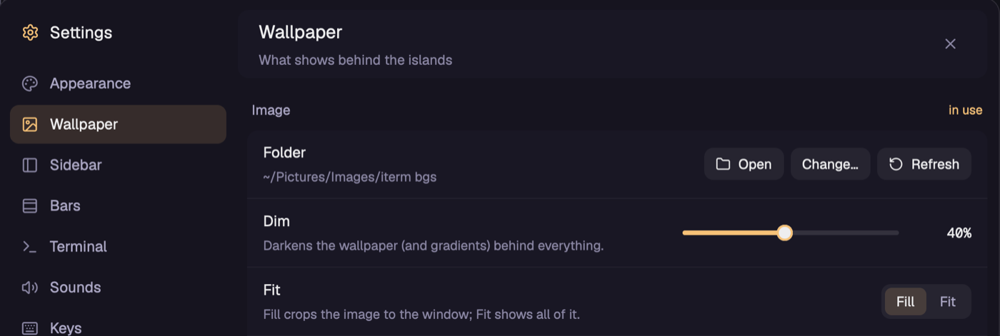

Pick your own wallpaper, a gradient, or a solid color, then dim the background
independently of the interface. Islands, cards, and panes each have their own
opacity; menus stay opaque, and Ctrl+A then `t` toggles transparency. This repo
ships a gradient and [no wallpaper artwork](docs/ASSETS.md).

### Settings panel

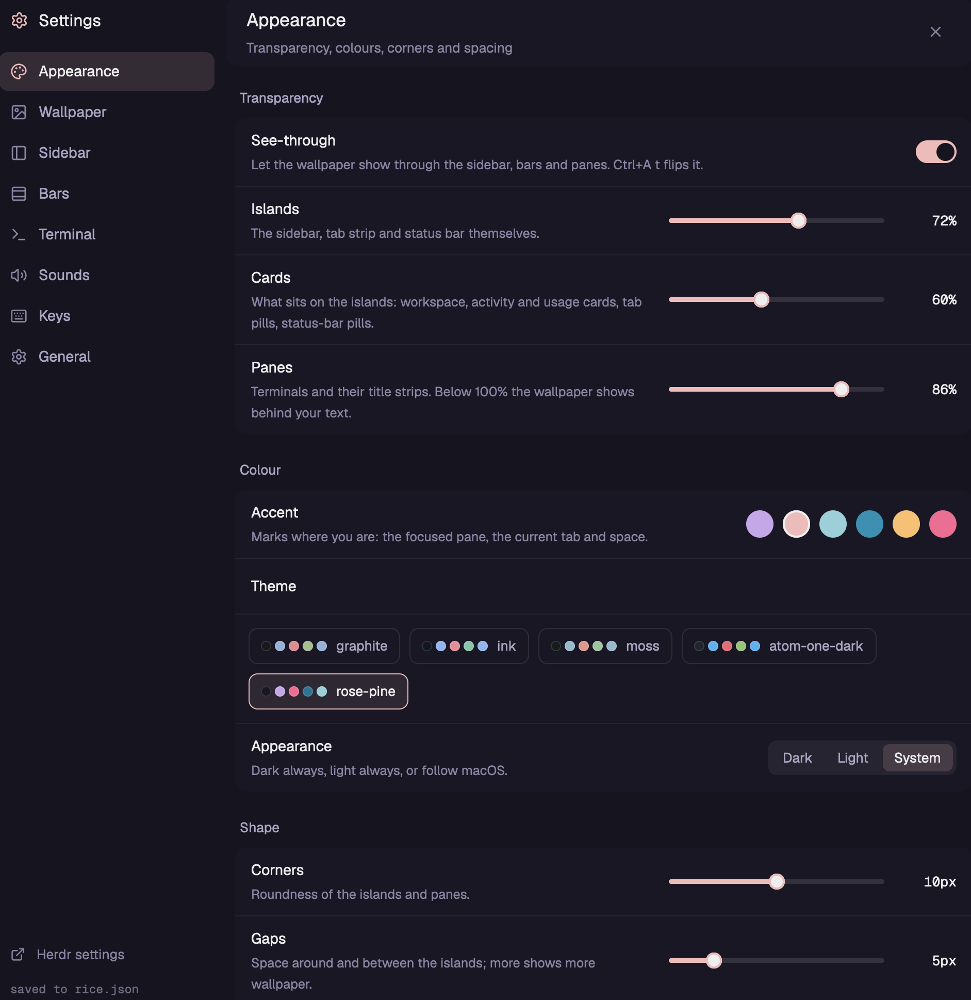

Cmd+, opens controls for appearance, wallpaper, the sidebar, bars, terminals,
sounds, and keys. Changes are saved through one settings writer, so the UI and
`rice.json` stay in sync.

### Go to, with vim modes

| NORMAL | INSERT (`/fore`) |
| --- | --- |
| 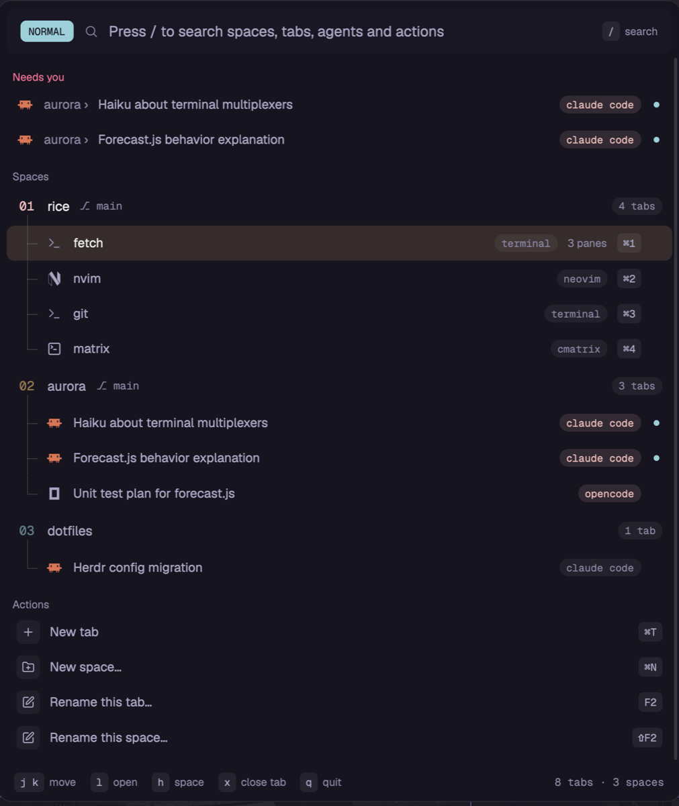 | 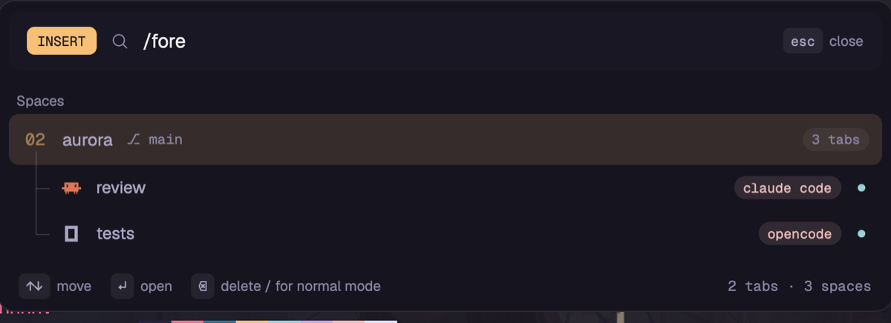 |

Cmd+P brings spaces, tabs, agents, and actions into one picker: `j/k` moves,
`l` or Enter opens, and `/` enters search/INSERT mode. Use `h` for the parent
space, `gg/G` for the ends, and Ctrl+D/U for half-page movement; Escape closes
the picker.

### Ctrl+A prefix menu

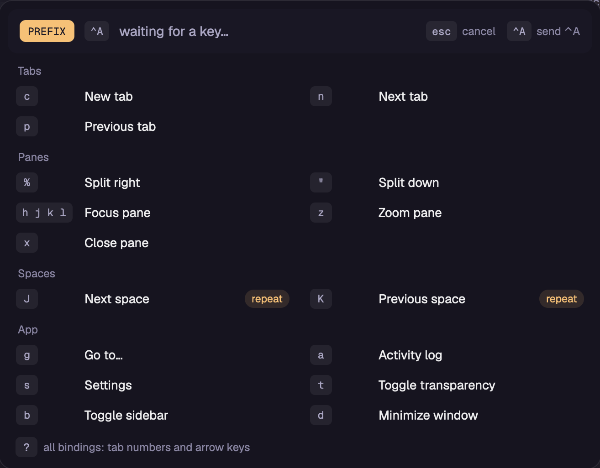

A visible cheat sheet groups tab, pane, space, and app actions. Press `?` for
all bindings, or Ctrl+A again to send the literal prefix to the terminal;
Shift+J/K can repeat space navigation within the configured repeat window.

### Numbered workspaces

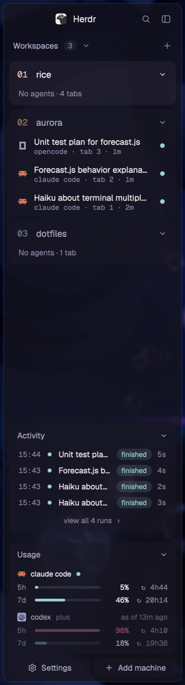

Zero-padded numbers sit beside semibold workspace headings, with agent rows
underneath and color reserved for location and status. Ctrl+1–9 selects a
workspace; a narrow sidebar becomes a compact rail. Below them, the activity
card lists the latest runs and the usage card shows your agent limits.

<br clear="right">

### Activity log: prompts and replies

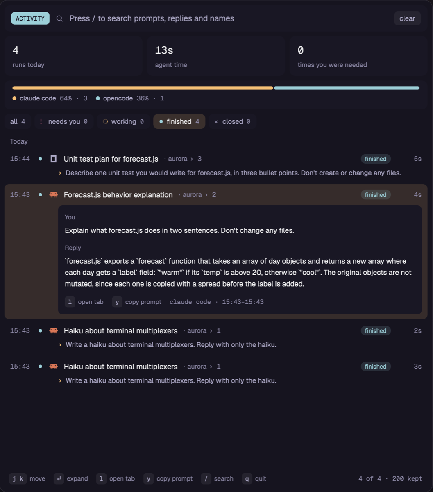

Ctrl+A then `a` opens one entry per run, with time, status filters, search, and
expandable prompts/replies supplied by the optional hooks below. `j/k` moves,
Enter expands, `l` opens the tab, and `y` copies the prompt.

### CPU, memory, and battery

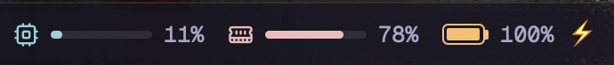

Compact meters show system CPU and memory percentages, plus battery charge
and charging state when available. Each item can be toggled in Settings → Bars.

### Now playing

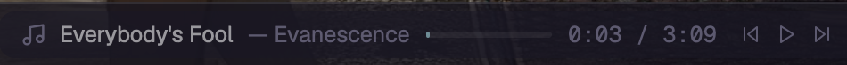

Spotify or Music contributes the track, artist, progress, and playback controls.
macOS may ask permission for Herdr to control the player; no player is required
for the rest of the layout.

### Wispr Flow

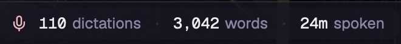

Today's dictation count, word count, and speaking time sit in a small status
pill. The helper reads only numeric
statistics and dates from the local database, never dictated text.

### Usage limits

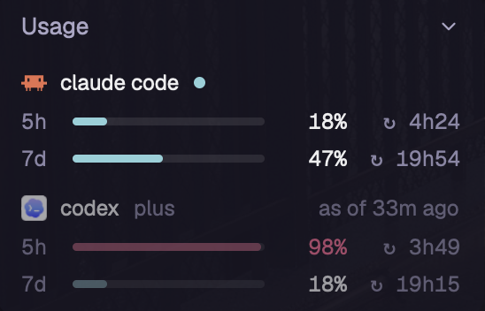

The sidebar shows 5-hour and 7-day usage with reset countdowns, using local
Claude Code status-line data and Codex session snapshots. Missing data remains
unknown; the card can show recent providers, live providers, or always show both.

## Requirements

- macOS and the [Herdr desktop app](https://herdr.dev), with `herdr-app` and
  `hc` on PATH. The copied mods pass checks on Herdr **0.1.13**.
- `python3` and its standard library for metrics, usage, and activity hooks.
  Wallpaper processing falls back to macOS `sips`; Pillow is optional.
- Optional: Spotify or Music, Wispr Flow, Claude Code, Codex, and OpenCode.
- Optional: `ffmpeg` to convert a selected macOS alert sound to MP3.
  Herdr's built-in sounds work without it.
- Geist, Geist Mono, and JetBrains Mono are supplied by Herdr.

These are trusted native mods. They run local helpers (`python3`, `git`, `hc`,
`osascript`, system metric tools, and optionally `ffmpeg`), read workspace Git
metadata, local agent logs/usage snapshots, wallpaper files, and Wispr's local
database. Settings write to the Herdr config; optional hooks write local activity
records. The custom mods have no direct network fetches; Herdr's machine controls
can connect to machines you configure. Review the code before installing.

## Install

Download or clone this repository, open Herdr once to create its shipped files,
then quit Herdr before copying. Use a detached config directory if your current
setup uses Stow or other symlinks: the installer refuses symlink destinations to
avoid changing their source repositories.

```sh
cd /path/to/herdr-rice
./install.sh
```

The installer first snapshots the entire existing `~/.config/herdr-app` into a
unique sibling `herdr-app-backup-*` directory. It then copies only `layouts/`,
`mods/`, `themes/`, `keys.json`, `rice.json`, `settings.json`, and license notices; it never deletes
files and does not install integrations, docs, or previews. The backup contains
your private runtime state, so keep it private.

This is a complete personal configuration: its keys and settings replace yours
after backup. If you want a selective installation, copy the three layout files
and required mod directories, merge the keys/settings, and resolve any existing
`my-*`, `sleek-*`, or `tmux-prefix` name collisions first. Renaming a mod requires
updating layout references, commands, and asset paths inside the mods too.

For a manual full installation, with Herdr closed and a config free of symlinks:

```sh
backup=$(mktemp -d "$HOME/.config/herdr-app-backup-XXXXXX")
if [ -d "$HOME/.config/herdr-app" ]; then
  cp -pR "$HOME/.config/herdr-app" "$backup/config"
fi
mkdir -p "$HOME/.config/herdr-app"
cp -pR layouts mods themes "$HOME/.config/herdr-app/"
cp -p keys.json rice.json settings.json "$HOME/.config/herdr-app/"
cp -p LICENSE NOTICE THIRD_PARTY.md "$HOME/.config/herdr-app/"
cp -pR licenses "$HOME/.config/herdr-app/"
```

Open Herdr, then activate the main layout:

```sh
herdr-app do layout.switch --name na29-islands
```

`my-combined` and `my-main` are included as older fallback layouts. They share
some settings and key actions, but the appearance writer targets `na29-islands`.

### Optional activity hooks

Back up each agent configuration before editing. Merge the provided `hooks`
entries into existing event arrays; do not replace unrelated hooks or duplicate
an existing `sleek-activity/hook.py` command. Nothing in the installer registers
hooks or changes an agent's configuration.

| Agent | Example to merge | Destination |
| --- | --- | --- |
| Claude Code | [Claude hooks](integrations/claude/hooks.json) | `~/.claude/settings.json` |
| Codex | [Codex hooks](integrations/codex/hooks.json) | `~/.codex/hooks.json` |

Both use `UserPromptSubmit` for `prompt` and `Stop` for `reply`. For example,
Claude's command is `python3 -I "$HOME/.config/herdr-app/mods/sleek-activity/hook.py" claude prompt`;
Codex uses `codex` in place of `claude`. Each command has a 5-second timeout.

For Codex, ensure this value is true in the existing `[features]` table in
`~/.codex/config.toml` (do not add a duplicate table):

```toml
[features]
hooks = true
```

Restart the agent and review/trust the new hooks through `/hooks` or the desktop
hook review UI. Current Codex enables hooks by default; the explicit setting
also matches this setup's original installer. Hook locations, events, and trust
behavior are documented in [OpenAI's hook guide](https://learn.chatgpt.com/docs/hooks).

For OpenCode, back up `~/.config/opencode/tui.jsonc` and any existing plugin
file, then copy [herdr-app-status.js](integrations/opencode/herdr-app-status.js)
to `~/.config/opencode/herdr-app-status.js`. Add `"./herdr-app-status.js"` to the
existing `plugin` array in `tui.jsonc` and restart OpenCode inside a Herdr terminal:

```json
{
  "plugin": ["./herdr-app-status.js"]
}
```

The supplied plugin has separate 1.x and 2.x TUI paths: **1.x records prompt/reply
text and status; 2.x currently reports status only**. It activates only when
`HC_TERMINAL_ID` is present. The Claude/Codex hook can also record unmatched
events outside Herdr and later match them by folder/time; running the agents
inside Herdr gives more reliable attribution.

Hooks keep up to 60 records per file under `~/.cache/herdr-activity/`, truncating
prompts to 4,000 characters and replies to 3,000. Herdr records run history while
open and retains it in local shared state (200 runs by default). These files
contain private conversations: keep them out of this repository. Activity hooks
collect text; agent status reporting is a separate Herdr/agent integration.

### Optional Claude usage data

Codex usage is read automatically from recent local session logs. Claude usage
needs its status line to save the `rate_limits` object it receives to
`~/.cache/agent-usage/claude.json` as `{"at": <epoch seconds>, "rate_limits": {...}}`.
See [the small stdlib writer and wiring instructions](integrations/claude/README.md).
Without a writer, Claude's card shows no reading; activity hooks do not provide
usage limits. Session and status-line formats may change between agent versions.

## Keys

`Ctrl+A → key` means press the prefix, release it, then press the next key.

| Key | Action |
| --- | --- |
| Cmd+P | Go to |
| Cmd+, | Personal Settings |
| Cmd+Shift+P | Herdr command palette |
| Cmd+N / Cmd+T | Name a new workspace / new tab |
| Ctrl+1–9 / Cmd+1–9 | Select workspace / tab |
| Cmd+Option+[ / ] | Previous / next workspace |
| Ctrl+Tab / Ctrl+Shift+Tab | Next / previous tab |
| Cmd+[ / ] | Previous / next agent |
| Cmd+D / Cmd+Shift+D | Split right / down |
| Ctrl+H/J/K/L | Focus adjacent pane; forward to terminal at an edge |
| Cmd+Option+arrow | Focus adjacent pane |
| Cmd+Option+Shift+arrow | Swap panes |
| Cmd+Shift+Enter | Zoom pane |
| Cmd+W / Cmd+Shift+W | Close tab / pane |
| F2 / Shift+F2 | Rename tab / workspace |
| Cmd+B | Toggle sidebar |
| Cmd+Shift+L | Cycle layouts |
| Ctrl+A → `s` / `g` / `a` | Settings / Go to / Activity log |
| Ctrl+A → `t` / `b` | Toggle transparency / sidebar |
| Ctrl+A → `c` / `n` / `p` | New / next / previous tab |
| Ctrl+A → `%` / `"` | Split right / down |
| Ctrl+A → `h/j/k/l` or arrow | Focus pane |
| Ctrl+A → `z` / `x` | Zoom / close pane |
| Ctrl+A → `J` / `K` | Next / previous workspace, repeatable |
| Ctrl+A → `1–9` / `0` | Tab 1–9 / tab 10 |
| Ctrl+A → `d` / `?` | Minimize / show all prefix bindings |
| Ctrl+A → Ctrl+A | Send literal Ctrl+A to the program |
| Escape | Close the current menu |
| Ctrl+Alt+Shift+Escape | Herdr's unbindable reset escape hatch |

Ctrl+A takes the shell's usual start-of-line binding; double it to forward it
(Cmd+Left also sends start-of-line). Ctrl+H/J/K/L go to the shell only when there
is no adjacent pane. Turn these bindings off in Settings → Keys if desired.

## Make it yours

Start with **Settings**. The shipped `rice.json` uses these flat keys:

| Keys | Meaning / shipped value |
| --- | --- |
| `background.kind`, `.gradient`, `.solid` | `gradient`; two colors plus angle; solid fallback |
| `background.dim`, `.fit` | 20% darkening; `cover` for images |
| `background.image`, `.source`, `wallpaper.folder` | Empty image/source; `~/Pictures/Wallpapers` |
| `transparency.on`, `.chrome`, `.cards`, `.panes` | Enabled; **opacity** 80%, 60%, 90% (higher = less transparent) |
| `look.accent`, `.gap`, `.radius` | `#eb6f92`, 5px, 10px |
| `look.borders`, `.focusRing` | Borders on; accent focus border off |
| `terminal.font`, `.fontSize`, `.padding` | Inherit font/size; 14px padding |
| `panes.header`, `tabs.numbers` | Pane headers and tab numbers on |
| `bar.*` | CPU, memory, battery, music, controls, Wispr, date/time, agents |
| `sidebar.activity`, `.usage` | Show sidebar cards |
| `activity.keep`, `.rows`, `.kinds` | 200 runs, 6 visible rows, recorded event kinds |
| `usage.claude`, `.codex`, `.mode` | Both providers; `recent` (`live` / `always` also supported) |
| `keys.prefix`, `.repeatMs`, `.hjkl` | `ctrl-a`, 500ms, directional pane keys on |
| `keys.namedSpaces`, `.settingsPanel` | Name new spaces; use personal Settings |

`my-keys` loads `rice.json` at start, then is the single writer for shared rice
changes, the look in `layouts/na29-islands.json`, and relevant bindings in `keys.json`.
Prefer Settings for look changes: editing `rice.json` alone while running is not
a live update, and restarting loads values without reapplying the whole layout.
For manual edits, quit Herdr, update the matching layout/key fields too, and
reopen. Herdr's own zoom, sound, and contrast settings live in `settings.json`;
panel sizing/visibility also use Herdr's layout state.

## Uninstall

Switch back with `herdr-app do layout.switch --name main`, then quit Herdr.
To restore a full backup without deleting your current config, move the current
directory aside and copy back the snapshot (substitute the backup path printed
by the installer):

```sh
saved=$(mktemp -d "$HOME/.config/herdr-rice-uninstalled-XXXXXX")
mv "$HOME/.config/herdr-app" "$saved/config"
cp -pR /path/to/herdr-app-backup-XXXXXX/config "$HOME/.config/herdr-app"
```

If there was no previous config, leave the moved copy as your archive and let
Herdr create a fresh default config on launch. For a selective uninstall, use
the backup's `installed-files.txt` to move only installed files aside and restore
their prior versions. Remove only the hook entries and OpenCode plugin entry
you added; preserve other agent settings. Local activity caches remain private
and are not removed automatically.

## Credits and sharing

Built on [Herdr](https://herdr.dev), with [Rosé Pine](https://rosepinetheme.com)
and [Geist](https://vercel.com/font). Licensed under [Apache-2.0](LICENSE), with
upstream notices retained. See [credits and third-party licenses](THIRD_PARTY.md)
and the [build recipe](RECIPE.md).

When publishing this repo yourself, add the GitHub topic **`herdr-layout`**.
Herdr's guide specifies a root `RECIPE.md`, `preview.png`, and the installable
folder structure; its directory normally picks up tagged public repositories
within an hour. No separate signup is required; community pictures are screened
before appearing, according to the [gallery's sharing instructions](https://herdr.dev/gallery/#share).
On GitHub, open the repository's **About → gear icon → Topics**, add `herdr-layout`,
and save. No GitHub repository is created by this project.
