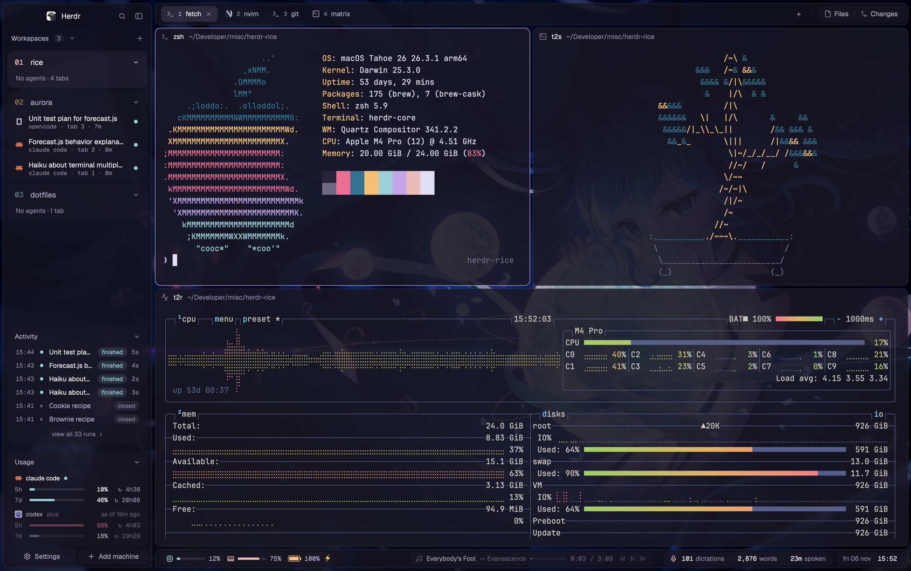

# NA29 Islands — Rosé Pine for Herdr

A macOS terminal and coding-agent desktop with a numbered workspace sidebar,
separate rounded islands for tabs, panes and status, a vim-style Go to menu,
and an expandable prompt/reply activity log. Appearance, keys and integrations
are controlled from one personal Settings panel. The preview is a real crop
of the prefix menu; a clean full-layout preview is pending.



## What you see

From left to right, a 268px sidebar and a flexible work area sit over a gradient
(`#342d40` → `#162a37`, 145°), darkened by a 20% black layer. The outer padding
and horizontal gap are 5px. The sidebar, tab strip, status bar and terminal
frames have 10px corners and 1px theme borders. Base chrome is `#16141f`, card
and pane color `#191724`, foreground `#e0def4`, muted `#aaa6c3`, dim `#8a86a3`;
the layout accent is `#eb6f92` over a Rosé Pine theme.

Words use Geist, numbers/keycaps use Geist Mono, and terminals inherit Herdr's
JetBrains Mono. The personal app zoom is 1.1. Accent indicates selection and
focus rather than decoration. Active tabs alone have a filled pill; other tabs
are bare until hover. There are no accent underlines or letter tiles.

The sidebar has a 46px brand row, flexible numbered workspaces with nested
agents, an Activity card, a Usage card, and a 40px footer with Settings and
Add machine. Workspace numbers are plain zero-padded type (`01`, `02`), headings
semibold, agent titles regular. Cards and groups use soft fills and a roughly
6px spacing rhythm. Workspace content has a 90px minimum height; card heights
adapt to their contents.

The work area has a 40px tab strip, flexible terminal panes (30px always-visible
headers), and a 32px status bar. Terminal padding is `[14, 12]`, pane gap 8px.
A hidden Files/Changes stack can open to the right, initially 368px wide
(280–900px). The status bar groups CPU, memory, battery, music with transport
controls, numeric Wispr Flow statistics, agent status and date/time.

The three opacity settings are independent: island chrome 80%, cards/pills
60%, panes 90%. Terminal background opacity is zero so the pane frame supplies
its tint. Menus are opaque: a chrome panel, dark filled fields, uppercase mono
mode labels, soft keycaps and footer hints.

## How it behaves

- Working agents have a gold native spinner; blocked agents a red `!`; done
  agents a foam dot. Idle agents are quiet (some picker rows use a hollow idle
  marker). The app distinguishes a completed unseen run from a viewed idle
  agent. Space/tab status follows the most urgent agent.
- Selecting a workspace, tab or agent navigates to it; headings fold groups.
  Sidebar controls collapse it to a rail (76px on macOS, 44px elsewhere) and
  restore its remembered width. Narrow workspace lists adapt below 160px;
  Activity/Usage compact at 140px. Sidebar width is bounded 44–480px.
- Tabs have a new-tab menu and Files/Changes controls; pane headers focus,
  split, zoom and close the target pane. Herdr's top-center grip handles pane
  dragging; pane boundaries resize. Top strips drag the native window.
- Cmd+P opens Go to (700px wide, top offset 56px, 80% window height). NORMAL
  mode uses `j/k`, `l`/Enter, `h`, `gg/G`, Ctrl+D/U. `/` enters INSERT search;
  deleting the leading slash returns to NORMAL; Escape closes. It finds spaces,
  tabs, agents and actions; `x` offers tab closing.
- Ctrl+A opens an opaque grouped prefix cheat sheet. `c/n/p` operate on tabs,
  `%`/`"` split, `h/j/k/l` and arrows focus panes, `z/x` zoom/close, `J/K`
  change spaces, `s/g/a` open Settings/Go to/Activity, `t/b` toggle transparency
  and sidebar, `d` minimizes. `?` reveals extra keys, 1–9/0 selects tabs 1–10.
  Only the space actions repeat, for 500ms by default; the initial wait has no
  timeout. A second Ctrl+A forwards the literal prefix.
- Cmd+, opens Settings (880px wide, 88% height). Its sections are Appearance,
  Wallpaper, Sidebar, Bars, Terminal, Sounds, Keys and General. Slider releases
  apply changes. Wallpaper selection copies the chosen image locally; gradients
  and solids require no image. Ctrl+A `t` disables/enables all three opacity
  layers together without changing their saved values.
- Ctrl+H/J/K/L focuses a neighbor or forwards the key to the terminal when no
  neighbor exists. Cmd+N asks for a workspace name before creating it. Cmd+B
  hides the sidebar without disabling the zero-height key/settings controller.
- Activity tracks one run from start to finish while the sidebar copy is alive.
  The log (760px wide, 84% height via the prefix menu) has summaries, status
  filters and search. `j/k`, `gg/G`, Ctrl+D/U navigate; Enter expands the prompt
  and reply, `l` opens its tab, `y` copies the prompt, `q`/Escape closes.
  Keep 200 runs and show six sidebar rows by default; clearing is confirmed.
- Usage reads 5h/7d windows, reset countdowns and recent/live provider state.
  No reading is displayed as unknown, not invented. Music controls operate on
  a running player. Wispr's pill shows numeric statistics, never dictated text.

## Built from

The main layout tree is:

```text
root (row: gradient, no system titlebar, traffic_lights [18,20])
└── dim (row: black alpha 0x33, padding/gap 5)
    ├── sidebar (column, 268px)
    │   ├── brand → sleek-chrome (46px)
    │   ├── sidebar-lists (column)
    │   │   ├── spaces → sleek-workspaces (flex)
    │   │   ├── activity → sleek-activity (initial 60px; fits content)
    │   │   └── usage → sleek-usage (initial 164px; fits content)
    │   └── sidebar-footer → sleek-chrome {footer:true} (40px)
    └── work (column)
        ├── tabs → sleek-tabs (40px)
        ├── work-body (row)
        │   ├── main → active tab; pane header sleek-pane
        │   └── panel (hidden column)
        │       └── panel-body (stack: files | changes)
        ├── status → sleek-status (32px)
        └── my-keys (0px, always alive)
```

`sleek-pane` receives Herdr's `pane` and `terminal` props. `sleek-chrome` uses
`footer:true` for the bottom controls. `sleek-activity` uses `log:true` or an
overlay prop to become the log; only its sidebar instance records runs.
Overlays are `my-goto`, `tmux-prefix`, `my-settings` and `my-prompt`; the prompt
receives the command/arguments to run after naming. The fallback layouts use
`my-chrome`, `my-spaces`, `my-agents`, `my-workspaces`, `my-tabs`, `my-pane`,
`my-status`, `my-activity`, `my-usage` and the same `my-keys` controller.

Use Herdr's shipped `files`, `changes`, `new-menu`, `machine-add`, prompt/menu
helpers, `workspace-chrome` SVGs, `icons/` and brand image. These are supplied
by Herdr and are not copied into the recipe package. Code uses `View`, native
builders, `InputState`, `SliderState`, focus handles, timers for polling and
native `.spin()` animation. No HTML, browser, Node APIs in mods, or JS timeouts.

Live state comes from `spaces`, `agents`, `panes`, `terminals`, `focused`,
`layout`, `theme`, `settings`, `keys`, `shared` and `localStorage`. Actions use
`run` commands for space/tab selection and creation, pane focus/split/zoom/close,
layout show/hide/resize/select, app preferences and overlays; `openOverlay` and
`closeOverlay` control dialogs. `hc` lists machines and forwards terminal keys.
`exec` runs local/remote Git status commands, Python helpers, AppleScript player
queries/controls, `pgrep`, `pbcopy`, `open`, `afplay`, `sips`, and optional `ffmpeg`.
System metrics use `ps`, `vm_stat`, `sysctl`, `pmset`; Wispr uses read-only SQLite.

`rice.json` is flat settings data loaded into shared `rice`. Both `my-keys` and
`my-settings` define matching DEFAULTS. Settings changes shared state;
`my-keys` alone writes rice, relevant keys and the `na29-islands` look. Herdr's
preferences remain in `settings.json`. Use `readTextFile`/`writeTextFile` with
expected prior contents, and `appHome()` for Settings writes.

The optional Python hook reads stdin JSON and, if needed, the tail of an agent
transcript, then writes local activity JSONL. OpenCode's plugin uses Node APIs
inside OpenCode, not inside a Herdr mod. Usage reads Claude's local snapshot
and recent Codex session logs. No cached data, personal art, sounds or font files
ship here; choose your own artwork and use Herdr's default sounds.

## Watch out

- Validate on Herdr 0.1.13 or a compatible gpui-kit API. `check` covers initial
  rendering, not deferred rows or every asynchronous state. Inspect real frames.
- `SliderState` with minimum above 100 aborts this app version: scale ranges
  down (sidebar width ÷4, repeat time ÷50), then scale released values back up.
- `line_height` is a multiplier. `.bg()` takes colors, not gradients. Use
  `#00000000`, not `transparent`; never pass null as a child or shadow a method
  with a data field. Every async callback needs its own context.
- DEFAULTS must match in both Settings and the writer. Appearance is written
  only when relevant shared rice fields change. Reading a manually changed
  rice file at startup does not itself reapply the layout; keep manual layout
  and key edits in sync. Do not edit Herdr's generated type files or shipped mods.
- Metrics, clipboard, media and wallpaper support assume macOS. Python stdlib
  works without Pillow; `sips` is the fallback. macOS sound conversion needs
  ffmpeg. Wispr/schema and agent log changes can make optional data unavailable.
- Some metric/usage helper paths use `home()/.config/herdr-app`; alternate
  HERDR_APP_HOME is suitable for checks, but is not a complete runtime sandbox.
- Claude usage needs a status-line snapshot writer; hooks alone are insufficient.
  The supplied OpenCode 2.x path has no prompt/reply recorder. No context-window
  bars are implemented for Codex/OpenCode.
- Shared run history and cache JSONL contain private text. Never publish them.
  Check existing overlays before screenshot automation; only close ones you own.
- The screenshot values reflect a live customization; package defaults are the
  documented snapshot. A full hero, full sidebar, INSERT picker and expanded
  sample activity still need privacy-safe retakes.

## Done when

1. Every copied mod passes `HERDR_APP_HOME="$PWD" herdr-app check "$PWD/mods/<name>"`;
   remove generated `gpui-kit.d.ts` and `jsconfig.json` afterwards.
2. Installing into a detached config preserves a complete backup, copies only
   the payload, and `layout.switch --name na29-islands` shows the islands. Fallback
   layouts can also be selected without missing personal mods.
3. Settings changes opacity independently for islands/cards/panes, dimming stays
   behind them, menus stay opaque, and values persist after restarting Herdr.
4. Go to switches between NORMAL and INSERT, opens a selected tab and closes on
   Escape. Prefix navigation, double-prefix forwarding, and pane-edge forwarding
   work. Hiding the sidebar leaves key actions available.
5. A harmless sample run appears once in Activity, expands to its prompt/reply
   with hooks installed, and can be searched and opened. Missing hooks/data
   produce an understandable empty/unknown state.
6. CPU/memory display, battery appears when present, media works when authorized,
   Wispr shows numbers only, and usage windows reflect real local snapshots.
7. Public images show no personal names, paths or conversations; the listing
   has a clean full-layout preview, this recipe and topic `herdr-layout`.
